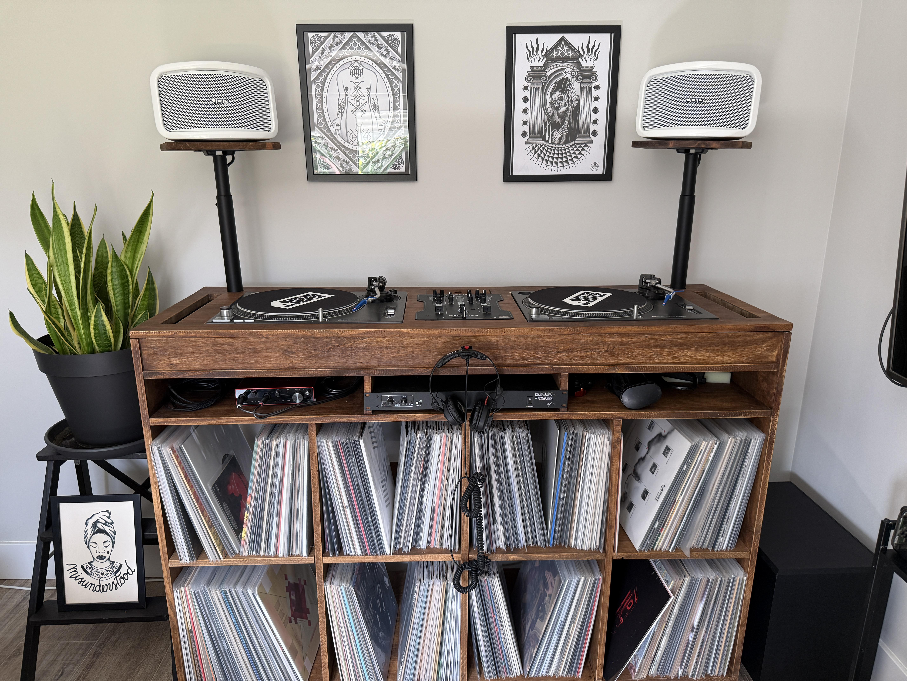

<h2 align="center">Hi there, I'm Luis </h2>

  Platform Engineer @ <a href="https://github.com/sequra">seQura Tech</a> · building <a href="https://drifthound.io/">DriftHound</a> · digging for records 🎶

  
  

  

### :rocket: What I'm up to

- **Platform Engineering at seQura**: Kubernetes, Terraform and the GitOps plumbing that keeps it all shipping.
- **[DriftHound](https://drifthound.io/)**: a platform to monitor infrastructure drift for Terraform, OpenTofu and Terragrunt.
- **Off the clock**: collecting and playing vinyl records.

### :hammer_and_wrench: Tooling Stack

  <b>CLOUD &amp; IAC</b> 
     

  <b>DELIVERY</b> 
    

  <b>OBSERVABILITY</b> 
    

  <b>CODE</b> 
  

  <b>LEARNING</b> 
   

### :bar_chart: Stats

  
  

  

### :pencil2: Blog

I write about platform stuff on [Medium](https://medium.com/@treezio).
